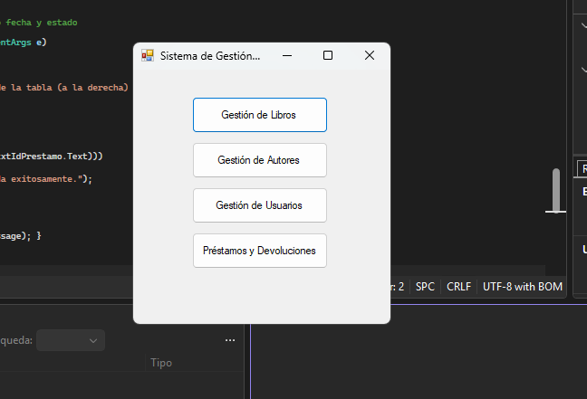
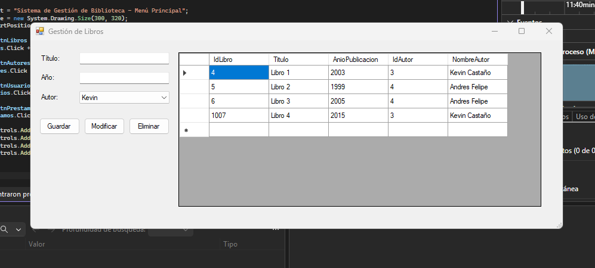
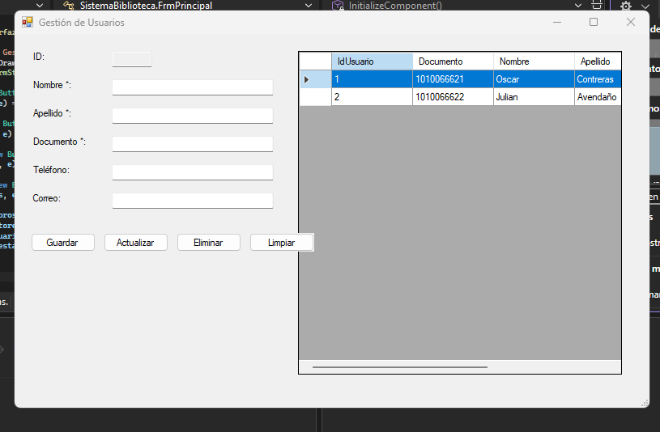
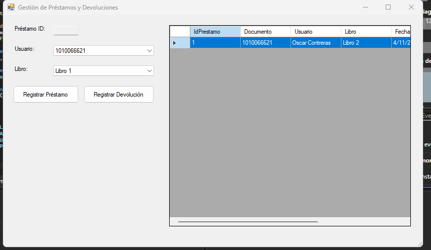
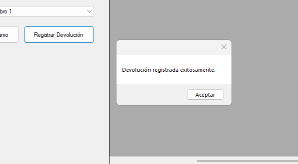

# Sistema de Gestión de Biblioteca

## PORTADA

**\[CORPORACIO UNIFICADA NACIONAL / CUN\]**

**\[PROGRAMACIÓN AVANZADA / 54467\]**

### ACA -- Programación Avanzada

### Sistema de Gestión de Biblioteca

**Presentado por:**

\[Oscar Julian Contreras Avendaño\]

**Docente:**

\[Veronica Castro\]

**Fecha:**

\[Bogotá\], 6 de noviembre de 2026

# CONTRAPORTADA

**Sistema de Gestión de Biblioteca**

Proyecto desarrollado como evidencia del curso de **Programación Avanzada**, aplicando Programación Orientada a Objetos, base de datos relacional, arquitectura por capas, operaciones CRUD, validaciones, manejo de excepciones y conexión con SQL Server.

**Estudiante(s):** \[Oscar Julian Contreras Avendaño\]

**Programa:** \[Programación Avanzada\]

**Grupo:** \[54467\]

**Docente:** \[Veronica Castro\]

**Institución:** \[Corporación Nacional Unificada CUN\]

**Año:** 2026

# TABLA DE CONTENIDO

 1. Introducción

 2. Objetivos

 3. Planteamiento del problema

 4. Análisis de requerimientos

 5. Casos de uso

 6. Diagrama de clases

 7. Modelo entidad-relación

 8. Diccionario de datos

 9. Arquitectura del sistema

10. Explicación de los módulos desarrollados

11. Capturas de pantalla del sistema

12. Pruebas de funcionamiento

13. Conclusiones

14. Recomendaciones

15. Referencias bibliográficas

# 1. INTRODUCCIÓN

El presente documento describe el desarrollo del **Sistema de Gestión de Biblioteca**, una aplicación de escritorio cuyo propósito es facilitar la administración del catálogo de libros, la gestión de los usuarios (lectores) y el control de los préstamos y devoluciones del material.

El sistema fue desarrollado utilizando **C# y Windows Forms bajo el entorno de Visual Studio**, integrando una base de datos relacional en **Microsoft SQL Server**. Se aplicaron principios de Programación Orientada a Objetos y una arquitectura lógica estructurada en tres capas (Presentación, Lógica y Datos).

La aplicación permite gestionar Libros, Autores, Editoriales y Usuarios, así como mantener un historial transaccional de los préstamos y devoluciones mediante operaciones CRUD parametrizadas.

# 2. OBJETIVOS

## 2.1 Objetivo general

Desarrollar un Sistema de Gestión de Biblioteca que permita automatizar el control de inventario y el préstamo de material bibliográfico, utilizando Programación Orientada a Objetos, una base de datos relacional y una arquitectura por capas.

## 2.2 Objetivos específicos

* Diseñar e implementar una aplicación de escritorio con Windows Forms para la gestión del catálogo.

* Aplicar principios de Programación Orientada a Objetos mediante el uso de clases Entidad (Modelos).

* Diseñar e implementar una base de datos relacional en SQL Server.

* Implementar operaciones CRUD para las entidades: Libros, Autores, Editoriales y Usuarios.

* Implementar validaciones de datos y manejo de excepciones (try-catch) para evitar cierres inesperados.

* Aplicar una arquitectura estructurada en 3 capas lógicas.

* Utilizar Git y GitHub para el control de versiones.

* Documentar técnica y funcionalmente el proyecto según los lineamientos de la rúbrica ACA.

# 3. PLANTEAMIENTO DEL PROBLEMA

## 3.1 Descripción del problema

La biblioteca requiere modernizar sus procesos de administración de información relacionada con los libros, autores, usuarios y préstamos. El manejo manual o en hojas de cálculo genera redundancia de datos, pérdida de historial de préstamos y dificultades para conocer la disponibilidad en tiempo real. Se necesita centralizar la información mediante un software que asegure la integridad de los datos, impida el registro de usuarios duplicados y facilite la trazabilidad del material prestado.

## 3.2 Justificación

Automatizar este proceso garantiza mayor seguridad y velocidad en la atención a los lectores. Adicionalmente, el uso de consultas parametrizadas en SQL Server protege la base de datos contra inyecciones SQL, mientras que la arquitectura por capas asegura que el sistema pueda escalarse fácilmente en el futuro.

## 3.3 Alcance

El sistema permitirá:

* Gestionar libros, autores y editoriales.

* Gestionar usuarios lectores.

* Registrar préstamos.

* Registrar devoluciones.

* Consultar un historial general a través de reportes en pantalla (DataGridView).

### Fuera del alcance

* Control financiero de multas y cobros.

* Autenticación de usuarios por roles (Login / Contraseñas).

# 4. ANÁLISIS DE REQUERIMIENTOS

## 4.1 Descripción general

El Sistema administrará catálogos (Libros, Autores, Editoriales, Usuarios) y controlará la tabla transaccional de Préstamos para reflejar el estado actual ("Prestado" o "Devuelto") de cada ítem.

## 4.2 Actores del sistema

| Actor | Descripción | 
| ----- | ----- | 
| Administrador / Bibliotecario | Usuario principal. Registra los libros, afilia a los lectores y opera los módulos de préstamo y devolución. | 

## 4.3 Requerimientos funcionales

| Código | Requerimiento | Descripción | 
| ----- | ----- | ----- | 
| RF01-03 | Gestionar Catálogo | CRUD completo de Libros, Autores y Editoriales. | 
| RF04 | Gestionar Usuarios | CRUD de Usuarios verificando documento único de identidad. | 
| RF05 | Registrar Préstamos | Permite asociar un Libro existente con un Usuario existente y guardar la fecha. | 
| RF06 | Registrar Devoluciones | Permite actualizar el estado de un préstamo a "Devuelto" usando la fecha del sistema. | 
| RF07 | Visualización / Reportes | Mostrar los datos combinados (INNER JOIN) en DataGridViews interactivos. | 
| RF08 | Menú Principal | Pantalla de navegación central para acceder a los módulos. | 

## 4.4 Requerimientos no funcionales

| Código | Requerimiento | Descripción | 
| ----- | ----- | ----- | 
| RNF01 | Usabilidad | Interfaz construida dinámicamente en Windows Forms, fácil de usar. | 
| RNF02 | Validación | Prevención de inserción de campos obligatorios en blanco. | 
| RNF03 | Arquitectura | Separación estricta en 3 capas (Presentación, Entidades, Datos). | 
| RNF04 | Seguridad BD | Uso exclusivo de consultas parametrizadas (`SqlCommand` parameters). | 

## 4.5 Reglas de negocio

* **RN01 - Datos obligatorios:** No se permiten usuarios sin número de documento ni libros sin título.

* **RN02 - Documento único:** La base de datos rechazará usuarios con documentos duplicados.

* **RN03 - Integridad referencial:** No se puede eliminar un Usuario o un Libro si tiene un Préstamo asociado activo.

# 5. CASOS DE USO

## 5.1 Descripción

El bibliotecario interactúa mediante formularios separados, gestionando entidades independientes que convergen en el módulo transaccional de Préstamos.

## 5.2 Descripción de casos de uso

### CU01 -- Gestionar Catálogo (Libros y Usuarios)

**Actor principal:** Bibliotecario
**Descripción:** Permite registrar, consultar, actualizar y eliminar entidades maestras.
**Flujo principal:**

1. El actor ingresa al formulario (ej. Usuarios).

2. El sistema lista los registros actuales.

3. El actor llena las cajas de texto y presiona Guardar o Actualizar.

4. El sistema valida los campos, envía la petición a SQL Server y refresca la tabla.

### CU02 -- Registrar préstamo / devolución

**Actor principal:** Bibliotecario
**Descripción:** Asigna un libro a un usuario o marca el retorno.
**Flujo principal:**

1. Seleccionar un usuario de la lista desplegable.

2. Seleccionar un libro de la lista desplegable.

3. Presionar "Registrar Préstamo". El sistema asigna estado "Prestado" y fecha actual.

4. Para devolver: Seleccionar el préstamo en la tabla y presionar "Registrar Devolución". El sistema actualiza la fecha final.

# 6. DIAGRAMA DE CLASES

*(Opcional: Adjuntar imagen de diagrama de clases si lo generaste)*

* **Clases Entidad (Modelos):** `Libro.cs`, `Autor.cs`, `Editorial.cs`, `Usuario.cs`, `Prestamo.cs` (Contienen propiedades puras).

* **Clases de Datos:** `DatosLibro.cs`, `DatosUsuario.cs`, `DatosPrestamo.cs`, etc. (Contienen los métodos transaccionales y de ejecución de sentencias SQL).

* **Clase de Conexión:** `Conexion.cs` (Gestiona la instancia de `SqlConnection`).

# 7. MODELO ENTIDAD-RELACIÓN Y 8. DICCIONARIO DE DATOS

La base de datos relacional implementada contiene 5 tablas principales:

### Tabla: Autores

| Campo | Tipo de dato | Clave | Nulo | Descripción | 
| ----- | ----- | ----- | ----- | ----- | 
| IdAutor | INT | PK (Identity) | No | Identificador único del autor. | 
| Nombre | NVARCHAR(100) | \- | No | Nombres y Apellidos. | 
| Nacionalidad | NVARCHAR(50) | \- | Sí | País de origen. | 

### Tabla: Editoriales

| Campo | Tipo de dato | Clave | Nulo | Descripción | 
| ----- | ----- | ----- | ----- | ----- | 
| IdEditorial | INT | PK (Identity) | No | Identificador único. | 
| Nombre | NVARCHAR(100) | \- | No | Razón social. | 
| Telefono | NVARCHAR(20) | \- | Sí | Contacto. | 

### Tabla: Usuarios

| Campo | Tipo de dato | Clave | Nulo | Descripción | 
| ----- | ----- | ----- | ----- | ----- | 
| IdUsuario | INT | PK (Identity) | No | Identificador. | 
| Nombre | NVARCHAR(50) | \- | No | Nombres. | 
| Apellido | NVARCHAR(50) | \- | No | Apellidos. | 
| Documento | NVARCHAR(20) | UQ | No | Documento de identidad (Único). | 
| Telefono | NVARCHAR(20) | \- | Sí | Número de contacto. | 
| Correo | NVARCHAR(100) | \- | Sí | Email. | 

### Tabla: Libros

| Campo | Tipo de dato | Clave | Nulo | Descripción | 
| ----- | ----- | ----- | ----- | ----- | 
| IdLibro | INT | PK (Identity) | No | Identificador del libro. | 
| Titulo | NVARCHAR(150) | \- | No | Título de la obra. | 
| AnioPublicacion | INT | \- | Sí | Año de publicación. | 
| IdAutor | INT | FK | No | Autor (Llave a Autores). | 
| IdEditorial | INT | FK | No | Editorial (Llave a Editoriales). | 

### Tabla: Prestamos

| Campo | Tipo de dato | Clave | Nulo | Descripción | 
| ----- | ----- | ----- | ----- | ----- | 
| IdPrestamo | INT | PK (Identity) | No | Identificador de transacción. | 
| IdUsuario | INT | FK | No | Llave foránea a Usuarios. | 
| IdLibro | INT | FK | No | Llave foránea a Libros. | 
| FechaPrestamo | DATE | \- | No | Fecha de asignación (GETDATE). | 
| FechaDevolucion | DATE | \- | Sí | Fecha de retorno. | 
| Estado | NVARCHAR(20) | \- | No | "Prestado" o "Devuelto". | 

# 9. ARQUITECTURA DEL SISTEMA

Se utilizó el patrón de arquitectura en 3 capas:

1. **Capa de Presentación (UI):** Archivos `Frm*.cs` que heredan de `Form`. Son las vistas generadas dinámicamente donde interactúa el usuario final.

2. **Capa Lógica (Entidades):** Archivos de clases genéricas que mapean la base de datos a objetos de C# (`Usuario.cs`, `Libro.cs`).

3. **Capa de Acceso a Datos (DAL):** Archivos `Datos*.cs`. Reciben las entidades y abren bloques `using(SqlConnection)` para inyectar sentencias parametrizadas y devolver `DataTables` a la interfaz.

# 10. EXPLICACIÓN DE CADA MÓDULO DESARROLLADO

* **Módulo Principal:** Formulario central enlazado por eventos `.Click` que sirve como orquestador del resto del programa.

* **Módulos Maestros (Libros, Usuarios):** Permiten capturar datos validando nulos, instancian un objeto y ejecutan los métodos Insertar/Modificar/Eliminar.

* **Módulo de Préstamos:** Utiliza consultas `INNER JOIN` en SQL para poblar la vista mostrando nombres legibles de Libros y Usuarios en lugar de IDs abstractos, mejorando fuertemente la usabilidad (RNF01).

# 11. CAPTURAS DE PANTALLA DEL SISTEMA

En esta sección se incluyen las evidencias de las principales funcionalidades desarrolladas mediante Windows Forms.

## 11.1 Menú principal

**Descripción:** Pantalla principal de navegación que conecta todos los módulos del sistema aplicando el RF08.

## 11.2 Gestión de libros y autores

**Descripción:** Módulo que permite el registro, consulta, actualización y eliminación de los libros en la base de datos (RF01 y RF02).

## 11.3 Gestión de usuarios

**Descripción:** Interfaz para administrar los usuarios de la biblioteca, validando campos obligatorios como el documento (RF04).

## 11.4 Registro de préstamos y devoluciones

**Descripción:** Módulo transaccional que permite asignar un libro a un usuario y registrar su posterior devolución (RF05 y RF06).

# 12. PRUEBAS DE FUNCIONAMIENTO

## 12.1 Estrategia de pruebas
Se realizaron pruebas unitarias manuales verificando la correcta inserción de datos en SQL Server y la validación de excepciones (ej. evitar campos nulos).

## 12.2 Evidencias de pruebas

### Prueba de Inserción Exitosa

**Resultado:** El sistema valida correctamente la lógica de negocio y almacena la información en la base de datos relacional mostrando confirmación visual.

# 13. CONCLUSIONES

1. El uso de la arquitectura en 3 capas facilita drásticamente el mantenimiento del proyecto. Si en el futuro se desea cambiar la base de datos de SQL Server a MySQL, solo es necesario modificar la "Capa de Datos", dejando intacta la interfaz y las entidades.

2. La validación en el formulario (Front) y las llaves Foráneas/Únicas en la base de datos (Back) previenen el 100% de los errores de consistencia en el programa.

# 14. RECOMENDACIONES

* Implementar a futuro un sistema de inventario (Stock) que no permita prestar un mismo libro simultáneamente si solo hay 1 ejemplar físico en existencia.

* Añadir un formulario de "Login" inicial para que los bibliotecarios tengan que usar una clave de acceso, protegiendo así la privacidad de los datos de los usuarios.

# 15. REFERENCIAS BIBLIOGRÁFICAS

* Microsoft. (2024). *Documentación oficial de .NET y C#*. Microsoft Learn.

* Microsoft. (2024). *ADO.NET y SqlClient para bases de datos*. Microsoft Learn.

# ANEXOS

**Anexo A. Repositorio GitHub:** [Ver repositorio en GitHub](https://github.com/oscarcontrerasa-afk/Aca-Programaci-n-Avanzada-Oscar-Contreras)

**Anexo B. Script de Base de datos:** Archivo `script.sql` adjunto en la entrega.